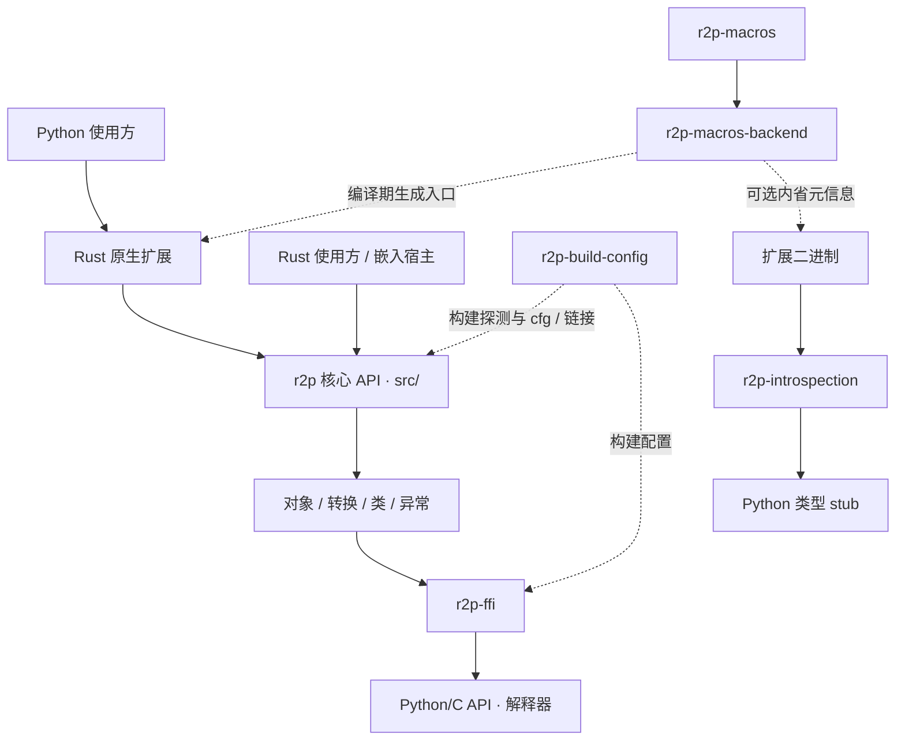

# r2p 总体技术方案

版本：2.0；日期：2026-10-24；状态：当前 SDK 生产研发方案。
产品名称为 `r2p`，实现包与来源记录在 [product.toml](../../product.toml)。
范围：[FR-001–FR-008](../requirements/system-requirements.md)。
技术负责人角色待分配。

## 1. 设计目标

保持 r2p 现有 Rust/Python 语义，通过目录分工、契约管理、可执行检查和交付记录降低持续开发成本。
采用单仓库、多组件工作区；核心库保留 Cargo 标准根包结构，工具和性能基准保持隔离依赖。

SDK 内核身份已经迁移为 r2p；本次进一步落实工程组织、依赖复现、源码交付和生命周期文档。
未来业务系统可依赖该 SDK，但必须另行定义接口、业务数据和运行服务边界。

## 2. 逻辑架构

实线表示调用/数据依赖；虚线表示构建期生成或配置。
宏后端负责生成代码，运行时行为由核心/FFI 实现，不能把宏编译成功当作扩展运行正确。
Python 运行时辅助包位于 `python/`，是否需要它取决于具体功能和打包方案。

## 3. 组件职责

| 层 | 实现 | 约束 |
| --- | --- | --- |
| 公共 API | `src/lib.rs`、`prelude.rs`、`types/` | 对使用方可理解；变化有迁移与测试 |
| 对象/生命周期 | `instance.rs`、`marker.rs`、`interpreter_lifecycle.rs` | 明确拥有/借用、线程附着和解释器有效期 |
| 类与协议 | `pyclass*`、`pycell*`、`impl_/` | 动态借用、GC、方法槽与生成代码一致 |
| 转换/错误 | `conversion.rs`、`conversions/`、`err/` | 错误走 `PyResult` / `PyErr`；禁止假定边界输入合法 |
| 低层 FFI | `crates/r2p-ffi/` | ABI、引用计数、空指针、版本条件和 unsafe 不变量 |
| 编译配置 | `crates/r2p-build-config/`、根 `build.rs` | 解释器/目标环境可解释，交叉编译不能误用宿主配置 |
| 宏 | `crates/r2p-macros*` | 解析→校验→生成；编译诊断纳入回归 |
| 内省 | `crates/r2p-introspection/` | 格式版本校验，兼容剥离/多架构二进制时需要实测 |
| 打包适配 | `tools/maturin-bridge/` | 私有 `pyo3-ffi` 协议入口，将元数据/ABI 特性转发到 r2p，禁止独立发行 |
| 工程验证 | `tests/`、`tools/`、`benchmarks/` | 测试行为、FFI 对照、基准各有职责 |

## 4. 关键流程

### 4.1 Python 调用 Rust 扩展

1. 打包工具读取 Cargo/Python 元数据，设置扩展构建条件。
2. 构建配置识别解释器、ABI、GIL 模式和平台。
3. 宏生成导出模块、函数/类入口及参数处理代码。
4. Python 导入动态库，由模块初始化注册对象。
5. 调用发生时提取参数、执行 Rust 逻辑、转换返回值或异常。
6. Python/Rust 对象根据所有权与借用契约释放；跨线程/GC 按对应路径处理。

异常输入、导入失败、借用冲突、panic 和解释器结束都必须有测试或明确限制。
业务调用方仍需对自身输入和副作用负责。

### 4.2 Rust 嵌入 Python

1. 宿主确保初始化和动态链接条件；可显式初始化或选择 `auto-initialize`。
2. `Python::attach` 将当前线程附着解释器。
3. 在对应 `'py` 生命周期内创建/调用 `Bound` 对象，必要时持有 `Py<T>`。
4. 将异常、返回值和线程释放行为传递给宿主。
5. 宿主负责进程退出、解释器生命周期与外部资源管理；不要把扩展构建模式用于嵌入链接需求。

### 4.3 生产交付

当前交付链路为已验证代码通过 PR 合并、固定 SHA 和历史快照；后续复现/修复反馈使用 PR，Issues 尚未启用。
`release.yml`、`python-wheel.yml`、Netlify 工作流的发布 job 默认关闭，需对应仓库变量显式启用。
注册表/站点发布另验收环境、身份、矩阵、制品和恢复，见[ADR-0003](adr/0003-delivery-and-history.md)。

## 5. 目录和依赖方案

根 `Cargo.toml` 是 `r2p` 主包兼工作区入口；`src/` 和 Rust `tests/` 保留。
支撑 crate 归入 `crates/`；跨语言测试归入 `tests/python/`；Python 包归入 `python/`；工具/基准保持独立 workspace。

这一选择减少主库 Rust 模块、集成测试和使用者入口的变更，同时实现职责聚合。
见 [ADR-0001](adr/0001-repository-layout.md) 和[完整迁移映射](../development/repository-layout.md)。

路径影响面必须联动：Cargo 依赖、Nox 脚本、mdBook include、Rust `include_str!`、CI `working-directory`/过滤器/缓存、Dependabot 和覆盖规则。
`tools/check_repository.py` 验证文件目标存在，Cargo metadata 和实际测试补充解析及行为验证。

## 6. 质量、并发和性能设计

- 安全边界：unsafe 代码需要指针有效性、引用所有权、对象布局、版本条件和线程前提的说明；借用检查与 GC 回归保护安全层。
- 线程边界：`Python<'py>` 证明线程附着；free-threaded Python 需要额外同步，不能假设 GIL 串行化所有访问。
- 错误边界：返回 `PyErr`，保持 Python 类型和 traceback 可用；panic 路径按当前实现测试，使用者应避免跨边界传播未经设计的 panic。
- 性能边界：跨语言频繁小调用、复制与转换、附着开销分别用基准观察；优化不得通过省略引用/线程检查破坏契约。
- 兼容边界：特性组合、MSRV、解释器实现、ABI 和平台共同决定支持状态；稳定/实验声明分开。

详细验收参见[接口约束](interfaces-and-compatibility.md)和[测试策略](../testing/test-strategy.md)。

## 7. 配置、制品和工程数据

编译配置使用 `R2P_*`；读取边界在新变量未设置时兼容 `PYO3_*`。
空值新变量仍优先，错误配置不静默回退；详见[配置注册表](../development/configuration-reference.md)。
根 Cargo.lock/uv.lock 已跟踪，MSRV 在隔离副本解析兼容依赖；工具链、锁和特性写入交付/发行记录。

SDK 源 crate、Python wheel/sdist、内省工具、文档站点是不同制品。
每项应标明来源 SHA、版本、兼容标签、依赖、许可证和哈希。
SDK 包名为 `r2p` / `r2p-*`，Python 包为 `r2p-runtime`；版权、许可和原始上游资料保持来源。
源码渠道和独立发行边界见 [ADR-0002](adr/0002-product-and-release-boundaries.md)。

## 8. 风险与处理

| 风险 | 触发 | 处理 / 验证 |
| --- | --- | --- |
| 路径漏改 | 构建/测试/指南引用旧目录 | G1、一致性检查、包内容与实际运行 |
| ABI 误配 | Python 实现、版本或 GIL 模式改变 | 标签检查、目标解释器导入、FFI 对照 |
| 生命周期问题 | 跨线程、GC、解释器初始化/结束 | 引用、borrow、GC 和竞态回归 |
| 上游同步冲突 | 后续拉取带来原路径或接口改动 | 独立同步分支、映射更新、完整回归 |
| 误用发行身份 | 本仓库仍采用上游 crate 名称 | 发布前完成命名/权限决策，按制品明确主体 |
| 文档超前 | 目标被误读为已实现 | 状态与证据分离；报告只写实际执行结果 |

## 9. 可选演进

按实际需求增加独立业务应用、统一制品目录、依赖锁定策略、监控平台或自动化回退。
增加任何长期运行服务时另建部署架构、API 和数据模型，记录资源/SLO/备份/值守责任，不能仅用空目录表示已实现系统。
